# Drittmaterial und Lizenzen

BatteryBuddy enthält folgendes Material Dritter. Einträge mit verifizierten Quellenangaben werden zusätzlich im App-Tab „Contributions“ angezeigt.

Die Vorschauen zeigen die entsprechenden Bilder aus dem App-Tab. Sie dienen nur der visuellen Zuordnung; maßgeblich für Herkunft und Nutzungsbedingungen sind die Quellen und Lizenzen in der Tabelle.

| Vorschau | Bezeichnung | Quelle / Urheber | Lizenz |
|---|---|---|---|
|  | AI-Icon (`ai.png`) | [Robot icons created by Magnific - Flaticon](https://www.flaticon.com/free-icons/robot) | Flaticon License: kostenlos für private und kommerzielle Nutzung mit Namensnennung |
| 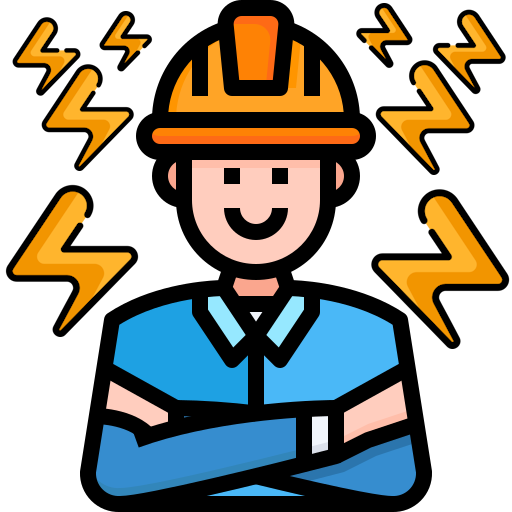 | Buddy icon (`batterybuddy.ico`) | [Electrician icons](https://www.flaticon.com/free-icons/electrician) von justicon – Flaticon | Flaticon License: kostenlos für private und kommerzielle Nutzung mit Namensnennung |
| 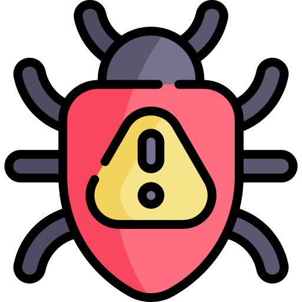 | Bug-Icon (`bug.png`) | [Virus icons](https://www.flaticon.com/free-icons/virus) von Magnific – Flaticon | Flaticon License: kostenlos für private und kommerzielle Nutzung mit Namensnennung |
| 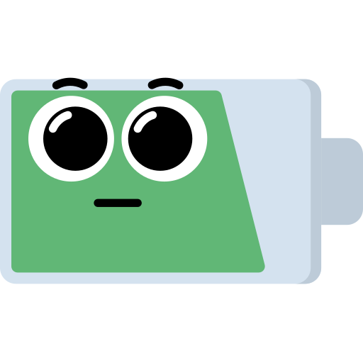 | Verwirrte-Batterie-Symbol | [Battery icons](https://www.flaticon.com/free-icons/battery) von Rohim – Flaticon | Flaticon License: kostenlos für private und kommerzielle Nutzung mit Namensnennung |
| 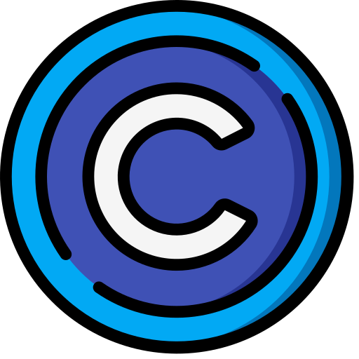 | Copyright-Icon (`copyright.png`) | [Copyright icons](https://www.flaticon.com/free-icons/copyright) von Smashicons – Flaticon | Flaticon License: kostenlos für private und kommerzielle Nutzung mit Namensnennung |
| 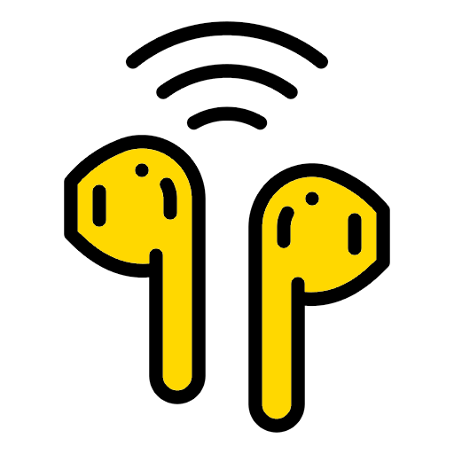 | Earbuds-Icon (`earbuds.png`) | [Headphone icons created by Kemalmoe - Flaticon](https://www.flaticon.com/free-icons/headphone) | Flaticon License: kostenlos für private und kommerzielle Nutzung mit Namensnennung |
|  | Everyone-Icon (`everybody.png`) | [Citizens icons](https://www.flaticon.com/free-icons/citizens) von Awicon – Flaticon | Flaticon License: kostenlos für private und kommerzielle Nutzung mit Namensnennung |
| 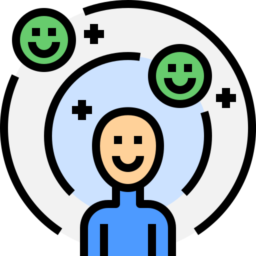 | Feel-good-Icon (`feel-good.png`) | [Optimistic icons](https://www.flaticon.com/free-icons/optimistic) von Parzival’ 1997 - Flaticon | Flaticon License: kostenlos für private und kommerzielle Nutzung mit Namensnennung |
|  | Kostenlos-Icon (`for-free.png`) | [Free icons](https://www.flaticon.com/free-icons/free) von Three musketeers – Flaticon | Flaticon License: kostenlos für private und kommerzielle Nutzung mit Namensnennung |
| 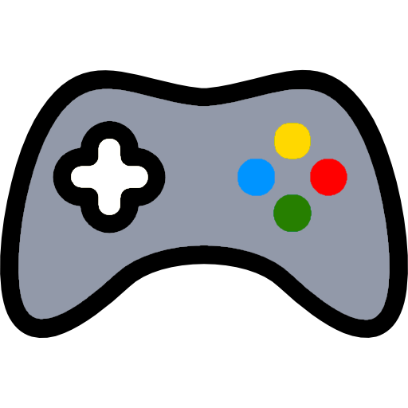 | Gamepad-Icon (`gamepad.png`) | [Joystick icons created by Good Ware - Flaticon](https://www.flaticon.com/free-icons/joystick) | Flaticon License: kostenlos für private und kommerzielle Nutzung mit Namensnennung |
| 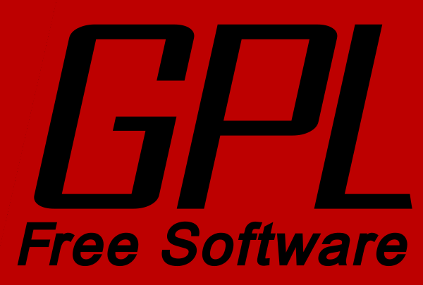 | GPLv3-Bild (`gplv3.png`) und zugeschnittene Vorschau (`gpl-icon.png`) | Offizielles GPLv3-Logo der Free Software Foundation; vom Projektinhaber über Wikipedia bezogen und für die Vorschau zugeschnitten. [Wikimedia-Dateiseite und Rechtebeleg](https://commons.wikimedia.org/wiki/File:GPLv3_Logo.svg); [GNU-Original und Nutzungserlaubnis](https://www.gnu.org/graphics/license-logos.html) | Gemeinfrei (Public domain); GNU erlaubt die Verwendung des Lizenzlogos in GPLv3-Anwendungen ausdrücklich. Keine Unterstützung oder Partnerschaft durch GNU/FSF oder Wikimedia behauptet. |
| 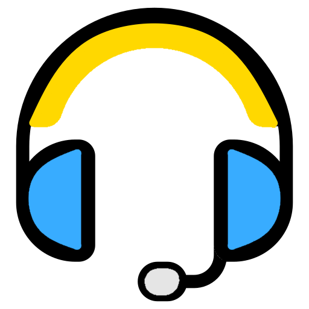 | Kopfhörer-Icon (`headphones.png`) | [Headset icons created by meaicon - Flaticon](https://www.flaticon.com/free-icons/headset) | Flaticon License: kostenlos für private und kommerzielle Nutzung mit Namensnennung |
|  | Idee-Icon (`idea.png`) | [Robot icons created by Magnific - Flaticon](https://www.flaticon.com/free-icons/robot) | Flaticon License: kostenlos für private und kommerzielle Nutzung mit Namensnennung |
| 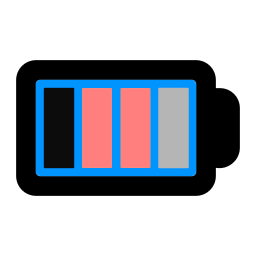 | Interne-Batterie-Icon (`battery-charge.png`) | [Low battery icons created by Us and Up - Flaticon](https://www.flaticon.com/free-icons/low-battery) | Flaticon License: kostenlos für private und kommerzielle Nutzung mit Namensnennung |
| 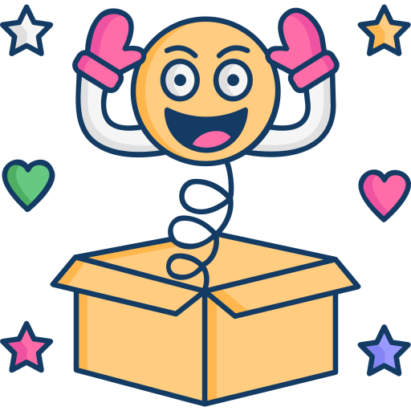 | Joke-Icon (`joke-orig.png`) | [April fools day icons](https://www.flaticon.com/free-icons/april-fools-day) von SBTS2018 – Flaticon | Flaticon License: kostenlos für private und kommerzielle Nutzung mit Namensnennung |
| 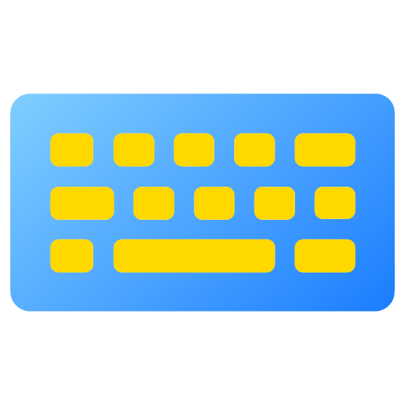 | Tastatur-Icon (`keyboard.png`) | [Typing icons created by meaicon - Flaticon](https://www.flaticon.com/free-icons/typing) | Flaticon License: kostenlos für private und kommerzielle Nutzung mit Namensnennung |
|  | Lizenz-Icon (`license.png`) | [Guarantee icons](https://www.flaticon.com/free-icons/guarantee) von Dewi Sari - Flaticon | Flaticon License: kostenlos für private und kommerzielle Nutzung mit Namensnennung |
| 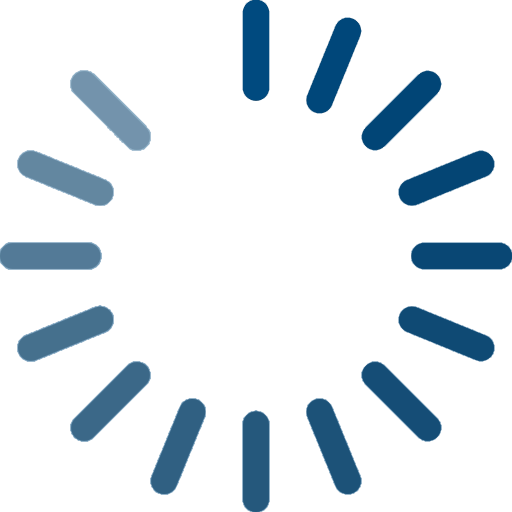 | Ladebalken-Symbol | [Loading icons](https://www.flaticon.com/free-icons/loading) von Krystsina Mikhailouskaya - Flaticon | Flaticon License: kostenlos für private und kommerzielle Nutzung mit Namensnennung |
|  | LOL-Icon (`lol.png`) | [Joke icons](https://www.flaticon.com/free-icons/joke) von Magnific - Flaticon | Flaticon License: kostenlos für private und kommerzielle Nutzung mit Namensnennung |
| 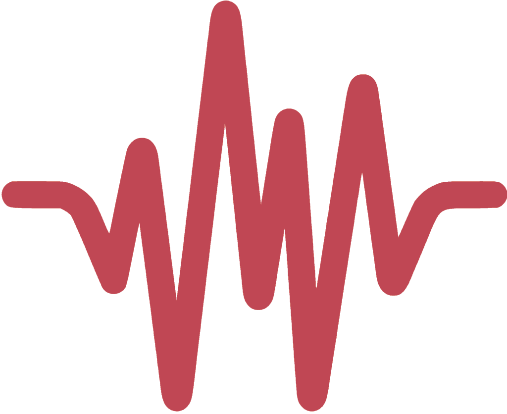 | Low Battery Sound (`src/BatteryBuddy.App/Assets/low-battery.wav`) | „Electric Toothbrush dead batteries 1.wav“ von sangtao – <https://freesound.org/s/190925/> | [CC BY 3.0](https://creativecommons.org/licenses/by/3.0/) |
| 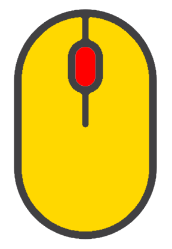 | Maus-Icon (`mouse.png`) | [Device icons created by alekseyvanin - Flaticon](https://www.flaticon.com/free-icons/device) | Flaticon License: kostenlos für private und kommerzielle Nutzung mit Namensnennung |
| 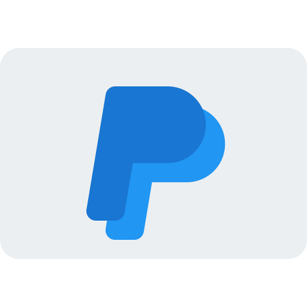 | PayPal-Icon (`paypal.png`) | [Paypal icons](https://www.flaticon.com/free-icons/paypal) von Pixel perfect - Flaticon | Flaticon License: kostenlos für private und kommerzielle Nutzung mit Namensnennung |
| 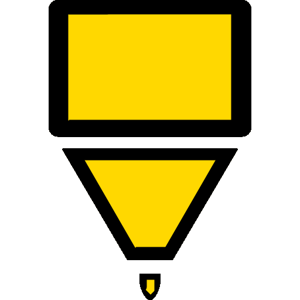 | Stift-Icon (`pen-tip.png`) | [Pen icons created by Magnific - Flaticon](https://www.flaticon.com/free-icons/pen) | Flaticon License: kostenlos für private und kommerzielle Nutzung mit Namensnennung |
| 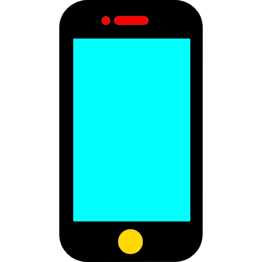 | Smartphone-Icon (`smartphone.png`) | [Smartphone icons created by Roundicons - Flaticon](https://www.flaticon.com/free-icons/smartphone) | Flaticon License: kostenlos für private und kommerzielle Nutzung mit Namensnennung |
| 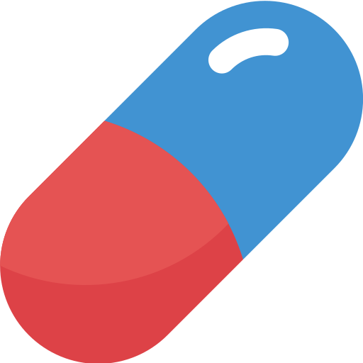 | Pill-Icon (`pill.png`) | [Capsule icons](https://www.flaticon.com/free-icons/capsule) von sonnycandra – Flaticon | Flaticon License: kostenlos für private und kommerzielle Nutzung mit Namensnennung |
|  | Quellcode-Icon (`open-source.png`) | [Open source icons](https://www.flaticon.com/free-icons/open-source) von Smashicons – Flaticon | Flaticon License: kostenlos für private und kommerzielle Nutzung mit Namensnennung |
| 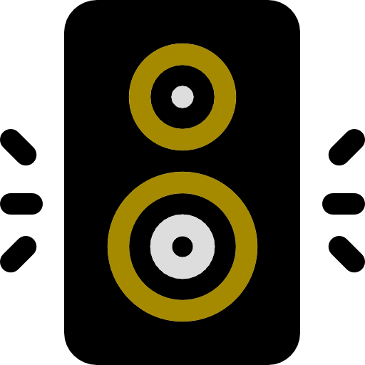 | Lautsprecher-Icon (`speaker.png`) | [Speaker icons created by Magnific - Flaticon](https://www.flaticon.com/free-icons/speaker) | Flaticon License: kostenlos für private und kommerzielle Nutzung mit Namensnennung |
| 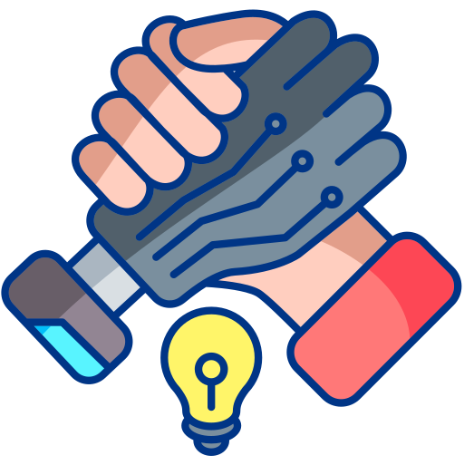 | Teamwork-Icon (`teamwork.png`) | [Idea icons created by Magnific - Flaticon](https://www.flaticon.com/free-icons/idea) | Flaticon License: kostenlos für private und kommerzielle Nutzung mit Namensnennung |
|  | Thunder icon | [Thunder icons](https://www.flaticon.com/free-icons/thunder) von Magnific – Flaticon | Flaticon License: kostenlos für private und kommerzielle Nutzung mit Namensnennung |
| 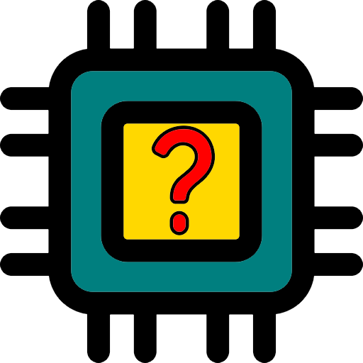 | Unbekannt-Icon #1 (`device-unknown.png`) | [Techonology icons created by Vitaly Gorbachev - Flaticon](https://www.flaticon.com/free-icons/techonology) | Flaticon License: kostenlos für private und kommerzielle Nutzung mit Namensnennung |
|  | Unbekannt-Icon #2 (`device-unknown.png`) | [Question icons created by Mzipi - Flaticon](https://www.flaticon.com/free-icons/question) | Flaticon License: kostenlos für private und kommerzielle Nutzung mit Namensnennung |

## Hinweise zur Einbindung

### Erweiterte experimentelle Geräteprotokolle

Die eigenen C#-Statusadapter orientieren sich an dokumentierten Protokollfakten
aus [Halo Battery (MIT)](https://github.com/HeyOkay/HaloBattery/tree/2251f0534a8e886c9692ead42056059b4f69d8c0)
und [HeadsetControl (GPLv3)](https://github.com/Sapd/HeadsetControl/tree/0c8a76fa019cd02263a1c69e00e18e229b16d87f).
Es werden keine fremden Programme oder Treiber gebündelt.
Die vollständige Zuordnung jeder implementierten Familie zu ihren Originalquellen
und deren Lizenz steht im App-Tab DeviceList und in [docs/protocols.md](docs/protocols.md).
Auch dort genannte Zwischenprojekte ersetzen nicht die Originalquelle.

Zusätzliche Protokollreferenzen umfassen OpenRazer und Linux-HID-Treiber
(GPL-2.0-or-later), Solaar (GPL-2.0-or-later), HyperHeadset, g933-utils, g930-battery-percentage,
lamzu-battery-monitory, mchose-linux, mchose-macos, sc2-research und
python-pulsar-mouse-tool (MIT), SDL (Zlib), rivalcfg (WTFPL),
alloyctl (GPLv2), keychron-battery-dkms (GPL-2.0-only),
AJAZZ Control Center (GPL-3.0-or-later) und G-Helper (GPL-3.0-only).
Der Halo-MIT-Hinweis bleibt unten vollständig erhalten; HeadsetControl unterliegt
der [GPLv3](https://github.com/Sapd/HeadsetControl/blob/0c8a76fa019cd02263a1c69e00e18e229b16d87f/license),
ebenso ist BatteryBuddys eigene GPLv3 in [LICENSE.md](LICENSE.md) enthalten.

Bei Web-Treibern, captures oder Notizen ohne nachgewiesene Lizenz wird keine
Kopiererlaubnis behauptet: Die Tabelle kennzeichnet dies ausdrücklich.
Dort dienen nur die beobachteten Paket-/Statusfakten als Referenz für eine eigene
Implementierung, nicht übernommener unlizenzierter Quellcode. Eine genannte
Quelllizenz ändert nicht automatisch die Lizenz aller davon unabhängigen Dateien.
Upstream-Hardwaretests sind keine Hardware-Verifizierung von BatteryBuddy.

### Audeze Maxwell / Maxwell 2

The independent native adapter uses battery-query facts from
[Halo Battery (MIT)](https://github.com/HeyOkay/HaloBattery/blob/2251f0534a8e886c9692ead42056059b4f69d8c0/providers/audeze.py)
and typed report framing / exact collection facts from
[HeadsetControl (GPLv3)](https://github.com/Sapd/HeadsetControl/blob/0c8a76fa019cd02263a1c69e00e18e229b16d87f/lib/devices/audeze_maxwell_device.hpp).
[Maxwell firmware research by kats1123 (CC BY 4.0)](https://github.com/kats1123/maxwell-firmware-research/blob/87c14d052a894d0322a209e0afb6f1697e36aed9/PROTOCOL.md)
informed the pre-query draining/stale-input limitation; no research prose or
firmware is redistributed. This is a new bounded C# implementation, not a copy
of the research document or a bundled Audeze HQ application. Changes include
explicit descriptor limits, cancellation, typed message validation and omission
of mode/settings initialization. Correlated replies do not prove that a
disconnected headset's receiver has sampled a new radio battery level.
License reference: [CC BY 4.0](https://creativecommons.org/licenses/by/4.0/).

### OpenMouse protocol references

[OpenMouse mouse-protocol b62a1cc (AGPL-3.0-or-later)](https://github.com/OpenMouse-Project/mouse-protocol/tree/b62a1cce2b63698ac00595efdb0067ecd54e34a0)
is a protocol-evidence source, not a bundled dependency or transplanted driver.
BatteryBuddy's new C# readers implement battery-only wire exchanges independently;
configuration, clock synchronization, firmware, pairing and mode writes are omitted.
No Bridge/Node.js runtime, upstream source files or vendor software are distributed.
The source license is stated for provenance, not relabeled as MIT or implicitly
applied to independent BatteryBuddy files.

Where traceable, the catalog also credits original references rather than only
OpenMouse: OpenRazer (GPL-2.0-or-later), libratbag's SinoWealth driver (MIT),
rivalcfg (WTFPL) and the model-specific sources listed in
[docs/protocols.md](docs/protocols.md). Vendor captures, moddoHUB-Web and mousectl
references without an established original URL/license are not assigned invented
licenses or claimed as copied source. See the applicable contribution labels in
[docs/protocols.md](docs/protocols.md). Upstream hardware observations do not
constitute BatteryBuddy hardware verification.

### TEEvolution Terra Pro protocol references

The independent battery-only C# adapter uses interoperability facts from
[OpenMouse mouse-protocol (AGPL-3.0-or-later)](https://github.com/OpenMouse-Project/mouse-protocol/tree/b62a1cce2b63698ac00595efdb0067ecd54e34a0/src/teevolution)
and the publicly accessible
[TeevoLink factory SDK](https://github.com/xilu7/teevolink/tree/26e0734589c8e09f1757f2cb6c809645fe06f61e/src/sdk).
The latter repository states no source reuse license; public accessibility is
not permission to copy it. No factory source, voltage table, assets, prose or
configurator is copied or bundled. Only packet identifiers, checksum arithmetic
and response field meanings inform the new implementation. The catalog names
both original sources and their license status rather than granting an invented
license to the factory material.

The native adapter omits OpenMouse's host-control enable/disable wrapper and
uses the zero-parameter online query corroborated by the factory protocol.
Exact descriptor/report guards, exclusive Windows access, bounded reads,
cancellation and invalid-response handling are BatteryBuddy-specific choices.
No new hardware verification is claimed.

### Flydigi Vader 5 Pro and EWEADN receiver protocol references

The independent battery-only readers use protocol facts from
[Vader Battery Tray (MIT)](https://github.com/vermi5/VaderBatteryTray),
[Halo Battery (MIT)](https://github.com/HeyOkay/HaloBattery/pull/352),
[EWEADN H2 Control (GPL-3.0)](https://github.com/MuhtasimJawad/EWEADN-H2-Control),
[USBDeviceBattery (no license stated)](https://github.com/YeLuoYuXiang/USBDeviceBattery),
[MouseDock (MIT)](https://github.com/late-autumn-gif/MouseDock) and
[MyFinder Device Battery (AGPL-3.0)](https://github.com/wushuai0802/myfinder-device-battery/issues/315).
These sources establish protocol/descriptor facts and upstream observations only;
their code, binaries, assets and prose are not copied or bundled. The A7 notes do
not state a source-code license, so they are not treated as reuse permission.
The EWEADN S9 Pro 8K report in MyFinder issue #315 is upstream device evidence,
not a BatteryBuddy hardware test. X23SE remains explicitly unconfirmed on real
hardware.

The Vader reader sends only `GET_INFO` and reports the source's coarse seven-step
scale as approximate percentages. EWEADN requests are limited to the exact
receiver collections, product names and report descriptors documented in
[protocols.md](docs/protocols.md); no pairing, configuration, firmware or lighting
commands are included. EWEADN A5 receiver support remains excluded.

### Experimentelle SteelSeries-Nova-7-Protokollunterstützung

Die Statusabfrage und Antwortauswertung wurden anhand von
[Halo Battery](https://github.com/HeyOkay/HaloBattery/blob/2251f0534a8e886c9692ead42056059b4f69d8c0/providers/steelseries.py)
(MIT), [HeadsetControl](https://github.com/Sapd/HeadsetControl/blob/0c8a76fa019cd02263a1c69e00e18e229b16d87f/lib/devices/steelseries_arctis_nova_7.hpp)
(GPLv3) und dem
[Linux-Arctis-Treiber](https://github.com/torvalds/linux/blob/master/drivers/hid/hid-steelseries-arctis.c)
(GPL-2.0-or-later; Copyright 2023 Bastien Nocera und 2026 Sriman Achanta)
entwickelt. Die Prüfung in Halo Battery ist kein BatteryBuddy-Hardwaretest.
Halo-Battery-Lizenzhinweis:

```text
MIT License

Copyright (c) 2026 Halo Battery contributors

Permission is hereby granted, free of charge, to any person obtaining a copy
of this software and associated documentation files (the "Software"), to deal
in the Software without restriction, including without limitation the rights
to use, copy, modify, merge, publish, distribute, sublicense, and/or sell
copies of the Software, and to permit persons to whom the Software is
furnished to do so, subject to the following conditions:

The above copyright notice and this permission notice shall be included in all
copies or substantial portions of the Software.

THE SOFTWARE IS PROVIDED "AS IS", WITHOUT WARRANTY OF ANY KIND, EXPRESS OR
IMPLIED, INCLUDING BUT NOT LIMITED TO THE WARRANTIES OF MERCHANTABILITY,
FITNESS FOR A PARTICULAR PURPOSE AND NONINFRINGEMENT. IN NO EVENT SHALL THE
AUTHORS OR COPYRIGHT HOLDERS BE LIABLE FOR ANY CLAIM, DAMAGES OR OTHER
LIABILITY, WHETHER IN AN ACTION OF CONTRACT, TORT OR OTHERWISE, ARISING FROM,
OUT OF OR IN CONNECTION WITH THE SOFTWARE OR THE USE OR OTHER DEALINGS IN THE
SOFTWARE.
```

Der Ton liegt inhaltlich unverändert vor (nur technisch von 24 auf 16 Bit umgewandelt, damit Windows ihn sicher abspielt).
Das App-Symbol wurde in eine mehrgrößige ICO-Datei (16–256 px) umgewandelt.
Die Contributions-Vorschau verwendet das unveränderte zusammengesetzte PNG-Original mit 512 × 512 Pixeln, nicht die kleine Standardebene der ICO-Datei.
Die zehn Kategorie-PNGs werden unverändert eingebettet und mit erhaltenem Seitenverhältnis skaliert.
Alle Kategorie-PNGs enthalten Transparenz.
Die drei Herkunfts-PNGs werden ebenfalls unverändert eingebettet und proportional bis zur vorhandenen Buttonhöhe (maximal 40 DIP) skaliert.
Die Contributions-Tabelle zeigt dieselben eingebetteten Bilder mit 22 DIP als Vorschau.
Die Lizenz- und Pro-Ansichten verwenden die hier aufgeführten Infografiken; das Pro-Bild `joke.png` ist ein zusammengesetztes Motiv aus den separat attribuierten Originalen `joke-orig.png` und `lol.png`.
Die vier Lizenzbilder werden mit maximal 150 DIP, das Pro-Motiv proportional mit maximal 150 × 198 DIP und die begleitenden Pro-Symbole mit 20 DIP angezeigt.
Die Fußzeile verwendet das Bug-Icon mit 18 DIP; das GitHub-Issue-Ziel ist fest vorgegeben und wird vor dem Öffnen auf HTTPS und den exakten Host geprüft.
Das Ladebild verwendet die vom Nutzer bereitgestellte blaue Fassung unverändert; dieselbe Ressource erscheint auch während der Geräte-Suche beim Start.
Beide Unknown-Quellen zeigen das zusammengesetzte Unknown-Bild; Buddy und Thunder jeweils das zusammengesetzte App-Symbol. Die Quellenlinks verweisen weiterhin auf die Originalmotive.
Die Tonquelle wird durch das vom Nutzer bereitgestellte Freesound-Plattform-Symbol (`freesound.png`, unverändertes Original mit 1024 × 836 Pixeln) veranschaulicht.
Das Freesound-Symbol bezeichnet die Quellplattform <https://freesound.org/>; die CC-BY-3.0-Angabe in dieser Zeile bezieht sich ausschließlich auf die Sounddatei, nicht auf das Plattform-Symbol.
